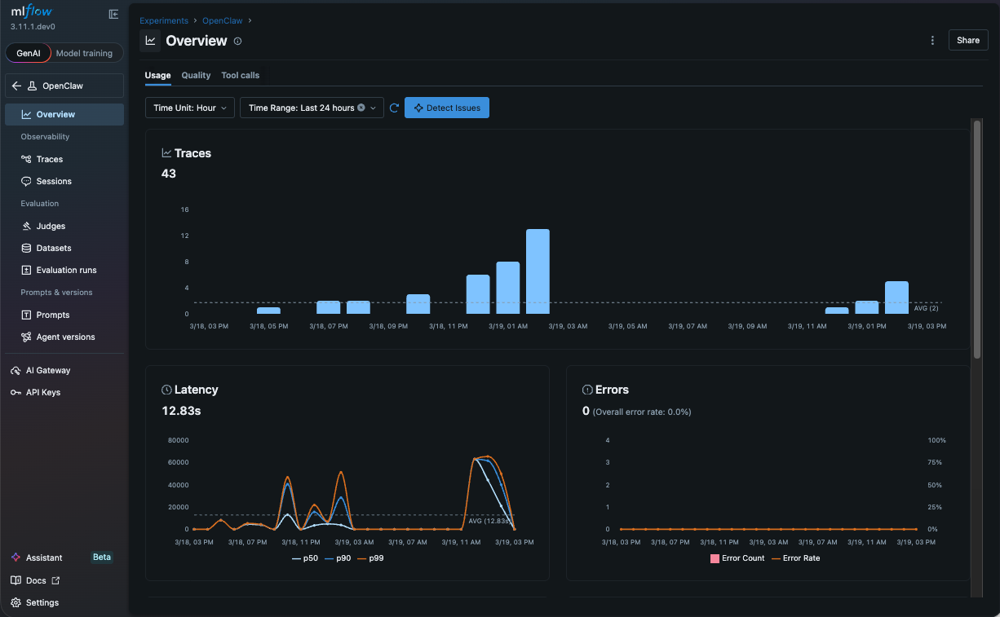
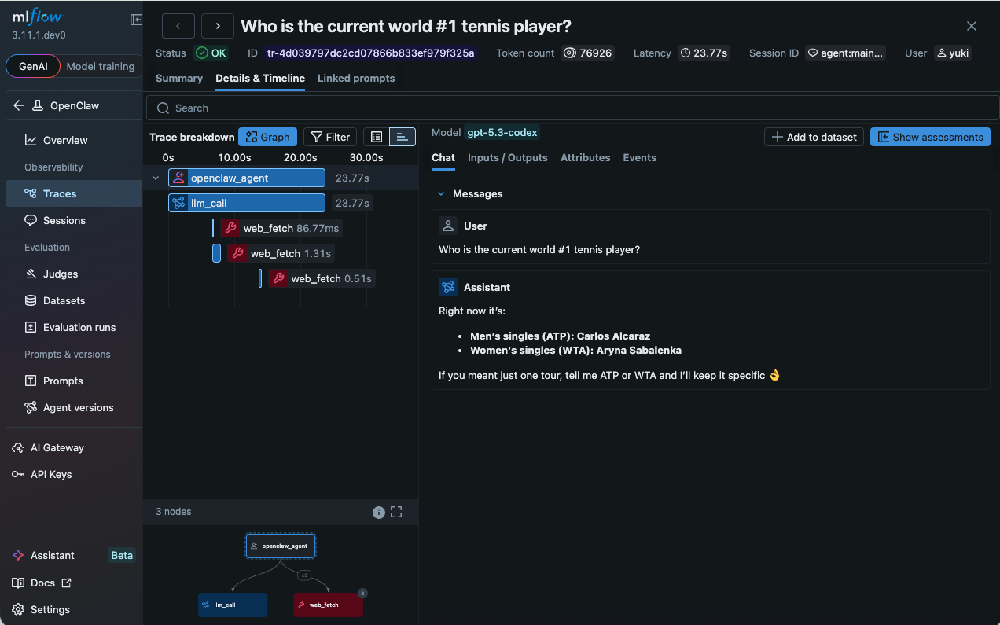

<h1 align="center" style="border-bottom: none">
    <a href="https://mlflow.org/">
        
    </a>
</h1>
<h2 align="center" style="border-bottom: none">🦞 OpenClaw MLflow Observability Plugin</h2>

<div align="center">

[](https://www.npmjs.com/package/@mlflow/mlflow-openclaw)
[](https://github.com/mlflow/mlflow/blob/master/LICENSE.txt)
<a href="https://twitter.com/intent/follow?screen_name=mlflow" target="_blank">
</a>
<a href="https://www.linkedin.com/company/mlflow-org/" target="_blank">
</a>

</div>

MLflow integration for [OpenClaw](https://github.com/openclaw/openclaw) for [observability](https://mlflow.org/docs/latest/genai/tracing/), [evaluation](https://mlflow.org/docs/latest/genai/eval-monitor/), and [monitoring](https://mlflow.org/docs/latest/genai/governance/ai-gateway/). This plugin automatically traces OpenClaw agent executions in MLflow, capturing LLM calls, tool invocations, and sub-agent spans in a hierarchical trace structure.

<p align="center">
  
</p>

## Key Benefits

- 🌐 **Open Source**: MLflow is 100% open source and governed by the Linux Foundation, rooted in the same philosophy as OpenClaw.
- 🛡️ **You Own Your Data**: MLflow is self-hosted. Trace data from OpenClaw stays on your infrastructure and never leaves it.
- 🔀 **Vendor Neutral**: MLflow works with any LLM provider or agent framework, with no vendor lock-in.

## Setup

Requires OpenClaw 2026.4.26 or later. Check your version with `openclaw --version`.

### 1. Install the Plugin

```bash
openclaw plugins install @mlflow/mlflow-openclaw
```

### 2. Start the MLflow Server

Start the MLflow server (self-hosting) following the [instructions](https://mlflow.org/docs/latest/genai/getting-started/connect-environment/). Alternatively, use a managed MLflow service if you prefer not to self-host.

### 3. Configure the Plugin

```
openclaw mlflow configure
```

Enter the MLflow tracking URI and experiment ID. You can [create an experiment](https://mlflow.org/docs/latest/genai/tracing/quickstart/#create-a-mlflow-experiment) from the MLflow UI. If the plugin does not already have [conversation access](#conversation-access), choose **Yes** to let it export conversation content in traces. The default is **No**.

```
~$ openclaw mlflow configure

┌  MLflow Tracing configuration
│
◇  MLflow Tracking URI
│  http://localhost:5000
│
◇  Experiment ID
│  2
│
◇  Allow MLflow to access conversation content and export it in traces?
│  Yes
│
└  MLflow configuration saved. Conversation access is enabled. Restart the gateway to apply.
```

### 4. Check the Status

Verify the configuration by running the following command:

```bash
openclaw mlflow status
```

If the configuration is successful, you should see the effective configuration in the output.

### 5. Talk to OpenClaw

Start the OpenClaw gateway, or restart it if it is already running. A running gateway reloads the plugin config on its own, but tracing picks up the new settings only after a restart.

```bash
openclaw gateway run  # or openclaw gateway restart
openclaw message send "Hello, Lobster!"
```

Visit the MLflow UI (e.g. http://localhost:5000) to see the trace.

<p align="center">
  
</p>

## Configuration

### Environment Variables

Tracking URI and experiment ID can also be set through environment variables:

```bash
export MLFLOW_TRACKING_URI=http://localhost:5000
export MLFLOW_EXPERIMENT_ID=<your-experiment-id>
```

### Conversation Access

OpenClaw runs the `llm_input`, `llm_output`, and `agent_end` hooks of a community plugin only when its entry grants conversation access. Choosing **Yes** in `openclaw mlflow configure` grants access. Choosing **No** saves the tracking URI and experiment ID without granting access or changing an explicit denial. The command leaves an existing grant in place without prompting.

To grant access manually, set the following in `openclaw.json`, including when you configure the tracking URI and experiment ID through environment variables:

```
{
    "plugins": {
        "entries": {
            "mlflow-openclaw": {
                "hooks": { "allowConversationAccess": true }
            }
        }
    }
}
```

Without it, the gateway blocks those hooks and exports no traces. `openclaw plugins doctor` lists the blocked hooks.

### Plugin Allowlist

OpenClaw shows a warning when a community plugin is installed but not declared in the [plugin allowlist](https://docs.openclaw.ai/tools/plugin#config). Add `mlflow-openclaw` to the plugin allowlist in your `openclaw.json` file to suppress the warning.

```
{
    "plugins": {
        "allow": ["mlflow-openclaw"]
    }
}
```

## What Gets Traced

The plugin creates a span hierarchy for each agent session:

```
AGENT (openclaw_agent)              ← root span
├── LLM (llm_call)                  ← each LLM interaction
├── TOOL (tool_<name>)              ← each tool invocation
├── AGENT (subagent_<label>)        ← sub-agent executions
└── ...
```

## Development

```bash
# Type-check
npm run typecheck

# Test
npm test

# Format
npm run format

# Lint
npm run lint
```

## License

This project is licensed under the Apache License 2.0 - see the [LICENSE](https://github.com/mlflow/mlflow/blob/master/LICENSE.txt) file for details.
